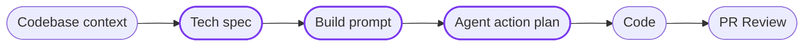

> ## Documentation Index
> Fetch the complete documentation index at: https://docs.blitzy.com/llms.txt
> Use this file to discover all available pages before exploring further.

# Chat with Code

> Explore your codebase, draft your Build prompt, and review source context through a conversational AI assistant

Use Chat with Code when you want to explore your codebase, draft your Build prompt, or ask questions about your source code with AI assistance. The chat drawer opens at the Tech spec step and carries its conversation forward through Build prompt and Agent action plan.

> [!NOTE]
>
> **Jump to:** [How it works](#how-it-works) | [Explore your codebase](#explore-your-codebase) | [Draft your Build prompt](#draft-your-build-prompt) | [Build Prompt Strength](#build-prompt-strength) | [Source Q\&A](#source-qa) | [Artifacts](#artifacts) | [Troubleshooting](#troubleshooting)

> [!NOTE]
>
> Chat with Code is in beta. The interface and capabilities may change.

## How it works

Chat with Code is a single conversation that spans three steps of the Existing product lifecycle. Each step gives the chat different capabilities, but the thread is continuous - what you discuss at one step is available at the next.

**Existing Product**

**New Product**

New product projects start at the Build prompt step and do not include Codebase context or Tech spec. Chat is available but limited to source-level Q\&A.

| Step | What the chat does |
| :- | :- |
| **Tech spec** | General codebase exploration - ask questions about your repository, trace dependencies, and understand architecture |
| **Build prompt** | Drafting, attachments, and scoring - the chat helps write your Build prompt, evaluates its strength, and suggests improvements |
| **Agent action plan** | Source-only Q\&A - ask questions about your codebase, but the chat does not discuss plan content or make edits |

## Explore your codebase

At the Tech spec step, Chat with Code explores your connected repository. Ask how authentication flows through your middleware, find where a function is defined, or trace a dependency chain across services. The chat searches files, reads source code, and navigates your folder structure so you understand the codebase before you start drafting.

## Draft your Build prompt

At the Build prompt step, the chat can draft your prompt and score it. The prompt editor and the chat work side by side - edit the document directly or ask the chat to revise sections for you.

### Getting started

When you open the chat with no saved Build prompt, the chat offers to draft one for you. It selects a drafting approach based on your build mode and generates an initial prompt you can edit.

### Attachments

The attachments rail lets you add context that shapes the Build prompt:

* **Rules** - coding standards, architectural patterns, or constraints the generation should follow
* **Files** - specific source files the chat should reference during drafting
* **Figma specs** - design files that anchor the prompt to visual specifications

Attachments are the only way to add or remove content the chat uses while drafting.

> [!NOTE]
>
> Attachment limits: 10 files, 2.8 MB per file, 10 MB total.

## Build Prompt Strength

The score widget evaluates your saved Build prompt against ten categories. Each passing category adds one point to a score out of ten.

* Objective
* Scope
* Technical specification
* Success criteria
* Constraints
* Architectural patterns
* Error handling
* File organization
* Testing
* Environment dependencies

| Verdict | Score | Meaning |
| :- | :- | :- |
| **Incomplete** | 0-4 | The prompt is missing significant coverage |
| **Needs work** | 5-7 | Some categories need attention |
| **Strong** | 8-10 | The prompt covers the key areas well |

A critical issue in any category caps the verdict at Needs work regardless of the total score.

### When scoring runs

Scoring evaluates the saved document, not the live editor buffer. It runs on three events:

* **Save from edit mode** - when you exit edit mode and save your changes
* **Save after a chat write** - when the chat finishes drafting or revising a section
* **First view** - once per project when no previous score exists for the current document version

While you edit, the previous score stays visible. After a save, the widget shows "Reassessing the build prompt" until the new score is ready.

> [!TIP]
>
> The score is advisory. It does not block submission or gate any workflow step.

### Improving your prompt

When the score surfaces issues, click **Help me improve this** to send those issues to the chat. The chat drawer opens if closed, and the chat receives the failing categories as context for its next response. It then suggests revisions to the weak sections.

The Improve button is disabled while a chat turn or evaluation is running, when the score has no issues, or for Viewer users.

## Source Q\&A

At the Agent action plan step, the chat shifts to source-only Q\&A. Ask which files implement a feature, how a module handles errors, or what a function returns - the chat answers from the codebase.

The chat does not discuss the plan's content, decisions, or rationale at this step. If you ask about the plan, it directs you to the plan document. It does not edit any project document here - prompt edits go back to the Build prompt step.

## Artifacts

The chat can generate artifacts alongside the conversation: diagrams, tables, and documents. Artifacts appear in a dedicated tab next to the Chat tab, and the artifact viewer docks as a third column on wider screens.

## Viewer access

Users with the Viewer role can read the chat transcript and see artifacts but cannot send messages or use the Improve action. If the project is a demo, locked, or Viewer-only at the project level, the chat drawer does not appear.

## Troubleshooting

> **Score shows 'Scoring failed'**
>
> The evaluation encountered an error. The widget displays the last successful assessment. Save the document again to retry.

> **Score shows 'Scoring timed out'**
>
> The evaluation took too long to complete. The widget falls back to the last successful assessment. Simplify the Build prompt or save again to retry.

> **Score shows 'Scoring is behind the document'**
>
> The document changed while scoring was in progress. The displayed score is from an earlier version. Save again to trigger a fresh evaluation.

> **Chat is not available**
>
> Chat with Code requires an Existing product project with a connected repository. Verify that your project is not archived or disabled, and that you are on a step where chat is active (Tech spec, Build prompt, or Agent action plan).

> **Improve button is disabled**
>
> The button disables while a chat turn or evaluation is running, when there are no scored issues, or for Viewer users. Wait for the current operation to finish, or confirm that the score has identified at least one issue.

> **Artifacts tab is not visible**
>
> The Artifacts tab appears when Chat with Code is active. If you do not see it, verify that the chat drawer is open and that your project meets the access requirements.

> **[Build prompt writing](../../build_preparation/generation_prompts.md)**
>
> Write and submit generation requests

> **[Agent action plan](agent_action_plan.md)**
>
> Review implementation plans before generation

> **[Tech spec review](technical_specification.md)**
>
> Review specs generated from ingestion

> **[Golden Rules](../../build_preparation/prompt_golden_rules.md)**
>
> Principles for writing effective prompts

This documentation is built and hosted on [Mintlify](https://mintlify.com), a developer documentation platform.