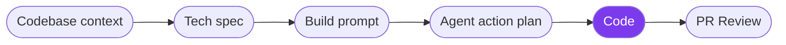
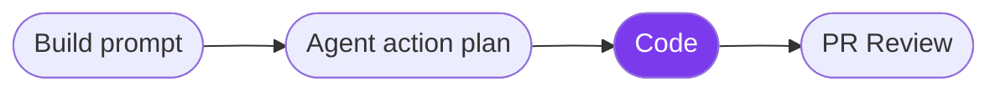

> ## Documentation Index
> Fetch the complete documentation index at: https://docs.blitzy.com/llms.txt
> Use this file to discover all available pages before exploring further.

# Code

> Track progress while Blitzy generates code, tests, and dependencies

This step runs after you approve the Agent action plan. Blitzy generates code, resolves dependencies, runs tests, and opens a pull request to your target branch. The workspace shows real-time progress through each phase.

> [!NOTE]
>
> **Jump to:** [Generation progress](#generation-progress) | [What to expect](#what-to-expect) | [When generation finishes](#when-generation-finishes)

**Existing Product**

**New Product**

## Generation Progress

The workspace displays four phases as Blitzy works through the approved plan. Each phase reports metrics so you can track where generation stands without waiting for it to finish.

| Phase | What happens | Visible metrics |
| - | - | - |
| **Managing dependencies** | Resolves packages, libraries, and internal modules the plan requires | Percent completed, files processed, total files |
| **Planning tests** | Determines which code reviews and QA tests to run against the generated output | Code reviews planned, QA tests planned |
| **Code generation** | Writes and commits code according to the approved AAP | Percent completed, files processed |
| **Testing & QA** | Runs test suites and validation checks against the generated code | Tests running, queued, passed |

Phases run in sequence. The workspace updates metrics in real time as each phase progresses.

## What to Expect

Generation time scales with project size, the number of files in the AAP, and the complexity of test coverage.

During generation:

* **The workspace stays open** - Close the tab or navigate away without interrupting generation. Return to the project at any time to check progress.
* **No input is required** - Generation runs autonomously from the approved AAP. You do not need to intervene unless you want to cancel.
* **CI/CD pipelines may trigger** - If your pipeline triggers on commit pushes to the Blitzy branch, it runs during generation. See [CI/CD Pipeline Timing](https://docs.blitzy.com/project-lifecycle/code-review#cicd-pipeline-timing) for how Blitzy uses those results.

## When Generation Finishes

Blitzy opens a pull request to your target branch and advances to PR Review.

**1. Review the Project Guide**

Blitzy generates documentation describing what changed and how the new code integrates with your existing codebase.

**2. Review the pull request**

Walk the generated PR grouped by purpose, with test evidence and review notes alongside the code.

**3. Merge, refine, or close**

Merge the PR, request targeted refinements, or close and start over with an improved prompt.

> **[Agent action plan](agent_action_plan.md)**
>
> Review and refine the plan before generation starts

> **[PR Review](pr_review.md)**
>
> Review the generated pull request and decide next steps

This documentation is built and hosted on [Mintlify](https://mintlify.com), a developer documentation platform.