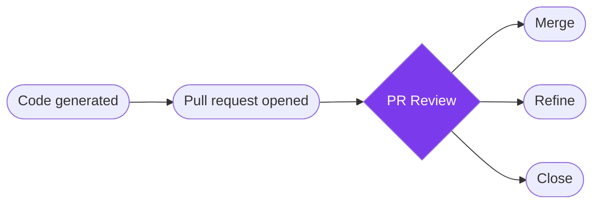

> ## Documentation Index
> Fetch the complete documentation index at: https://docs.blitzy.com/llms.txt
> Use this file to discover all available pages before exploring further.

# PR Review

> Review a generated pull request as an ordered sequence, then merge, refine, or close

Blitzy pull requests can touch hundreds of files across several repositories. Engineers sifting through code sorted by filename learn nothing about intent, leaving reviewers to reconstruct requirements while large reviews sit open for days.

PR Review draws from the knowledge graph's understanding of your codebase to group changes by purpose, annotate each file with the reasoning behind it, and surface test evidence alongside the code - so a 400-file review across four repos is something you can actually finish.

> [!NOTE]
>
> **Jump to:** [Where PR Review fits](#where-pr-review-fits) | [Two review modes](#two-review-modes) | [Reviewing a change](#reviewing-a-change) | [Review notes and test evidence](#review-notes-and-test-evidence) | [Triage by risk](#triage-by-risk) | [After the review](#after-the-review) | [Data & Privacy](#data--privacy)

## Where PR Review Fits

PR Review is the step you reach after code generation. The Project Guide opens the sequence, followed by numbered groups of changes and the evidence behind them. From here, you decide: merge, refine, or close.



> [!TIP]
>
> PR Review supplements the higher-leverage gates described in [Code Review](code_review.md) - the Agent action plan review and dynamic validation still catch more, earlier, and at lower cost.

## Two Review Modes

**Key changes**

The default mode whenever the pull request contains at least one key change.

* Covers only the changes most likely to need a human decision: architectural edits, high-risk changes, and points where judgment matters
* The shortest path through a large pull request

If no key changes exist, **All files** is the only sequence.

**All files**

The complete sequence, in the same order.

* Every changed file, including the ones **Key changes** leaves out
* Key changes carry a **Key change** marker so you can distinguish them

In both modes the **Project Guide** is the first item in the sequence.

## Reviewing a Change

**1. Start with the map**

PR Review opens on the Project Guide in **Key changes** mode. The position counter (for example, 1/31) shows where you are and how far you have to go.

**2. Walk the sequence**

**Next** and **Prev** (or arrow keys) move through changes in the order Blitzy generated them. Stop, close the tab, and pick up where you left off.

**3. Use the sidebar**

**Grouped changes** shows every numbered group and file. A summary line like "31 key changes · 18 groups · 4 repos" gives the scope at a glance. Select any file to jump to it.

**4. Read in context**

Each group has a title and description explaining what the changes accomplish. The file header shows the repository path, position within the group, and diff stats.

**5. Check the reasoning and evidence**

**Review notes** in the right sidebar explain why the change was made. **Testing & QA** along the bottom shows the test results Blitzy produced for that file.

## Review Notes and Test Evidence

**Review notes** draw from the knowledge graph's map of your codebase - architecture, patterns, dependencies - and appear in the right sidebar, one card per observation. Each note has a title, an explanation, and a source citation.

* Selecting a note highlights the lines it concerns. Selecting a highlighted line brings up its note.
* A note can anchor several separate ranges of one file.

**Testing & QA** along the bottom carries the evidence Blitzy produced for that file: an overview, individual checks with pass/fail status, and a **Behavioral Evidence** section describing what Blitzy observed at runtime.

## Triage by Risk

A 400-file pull request does not mean 400 decisions. Most files fall into patterns your validation pipeline already covers - the review is about finding the ones that do not.

| Tier | Examples | Review Approach |
| - | - | - |
| **Deep** | Business logic encoding regulatory or contractual rules, auth and session management, data persistence and migration, external system integrations | Full human review by domain owner |
| **Standard** | New service scaffolding, API endpoint implementations against a defined spec, data transformation in well-tested modules | Standard peer review |
| **Light** | Boilerplate from established patterns, test file generation, non-production config and infrastructure-as-code | Dynamic validation + spot-check |

> [!TIP]
>
> Use a coverage statement in your PR approval: "I validated the architecture, reviewed the API contracts and auth flow, spot-checked implementation in these areas, and ran the test suite. I have not reviewed X, Y, and Z in detail." Transparency about coverage is more valuable than a false sense of thoroughness.

## After the Review

Selecting **Finish** on the last item confirms you reached the end of the sequence. Finishing changes nothing about the pull request - merge, refine, and close are separate, deliberate actions.

### Merge

Merge when the code works, the tests prove it, and the Project Guide confirms the plan was followed.

| Criteria | Requirement |
| - | - |
| **Critical gaps** | Zero |
| **Major gaps** | 3 or fewer (or refinement complete) |
| **Project guide completion** | 80% or higher |
| **Build status** | Passing |
| **Tests** | Passing (if applicable) |

**Gap severity:**

* **Critical** - Security vulnerabilities, broken core functionality, data loss risks, architectural violations
* **Major** - Missing error handling, incomplete features, performance issues, inadequate testing
* **Minor** - Code style inconsistencies, documentation improvements, minor optimizations

**1. Verify project guide completion**

Compare PR file changes against project guide requirements and verify 80% or higher completion. See [Project Guide Review](project_guide.md) for detailed steps.

**2. Test locally**

Pull the branch and verify the build and tests pass:

```bash theme={null}
git fetch origin
git checkout [branch-name]
git pull origin [branch-name]
```

**3. Assess code quality**

Review for adherence to codebase patterns, error handling, style consistency, integration with existing code, and performance.

If critical gaps exist, [close](#close). If major gaps exceed 3, [refine](#refine).

#### Merge Conflicts

Select **Fix Merge Conflicts** from the Blitzy PR dropdown menu. Blitzy rebases your branch and regenerates conflicting sections while preserving the original intent.

#### Projects with Submodules

Clicking **Merge PR** merges the parent repository and all writable submodule PRs in a single action.

> [!WARNING]
>
> Do not manually close or merge submodule PRs while refine cycles are in progress. Refine reads from submodule branches - closing them causes build failures or incomplete refinements.

### Refine

Use Refine when the code is fundamentally sound but specific implementations need modification. You are requesting targeted changes, not a rework.

Refine can also lightly redefine the scope of the Agent action plan. The refine scoping agent treats the refine prompt as primary over the AAP and records an explicit override citing the AAP section it supersedes - so calling out deferred items or reopening a narrow scope boundary is possible without closing the PR.

Structure feedback using critical directives:

```
Directive: Fix missing error handling in src/services/payment-processor.ts lines 145-167 by adding try-catch blocks around API calls and returning structured error responses

Directive: Achieve 100% test passing rate - currently 3 tests failing in tests/unit/payment-processor.test.ts due to unhandled promise rejections

Directive: Maintain existing authentication middleware in src/middleware/auth.ts unchanged - only modify payment processing logic

Directive: Reference error handling pattern from src/services/user-service.ts lines 89-112 for consistency with codebase standards

Directive: Reopen the deferred caching layer from the AAP and implement it using the Redis pattern in src/services/cache.ts
```

> **Be specific**
>
> Reference exact file paths and line numbers. Describe concrete changes, not vague improvements. Provide measurable success criteria.

> **Scope adjustments**
>
> Refine can reopen deferred items or lightly extend AAP scope when the refine prompt explicitly calls them out. The scoping agent records which AAP section it overrides and why. For large scope changes - a fundamentally different approach or new major features - close the PR and start a new run instead.

> **Reference patterns**
>
> Point to existing code examples in your codebase. Specify architectural patterns to follow.

### Close

Close when the generated code has fundamental issues that make refinement inefficient. Iterate on your prompt before creating a new generation request.

| Condition | Reason |
| - | - |
| **Critical gaps >0** | Security vulnerabilities, broken core functionality, architectural violations |
| **Architectural approach flawed** | Fundamental design requires complete rework |
| **Major scope misalignment** | Scope diverges beyond what Refine can adjust with a light AAP override |
| **Refinement inefficient** | Would require 3+ iterations or exceeds effort to regenerate |

**1. Document critical gaps**

For each gap: file path and line numbers, what is wrong, why it blocks merge, and why the generation failed.

**2. Identify root cause**

Unclear prompt, missing context, wrong approach in the AAP, or incomplete project guide.

**3. Close with explanation**

State the decision, list gaps, explain why regeneration is preferred, and provide next steps.

**4. Refine your prompt**

Update with clearer requirements, add missing context, reference specific patterns, and address root causes.

> [!NOTE]
>
> When a file's diff is not available - for example, because Blitzy can no longer access the repository, the commits were removed, or the file is binary or too large to display - review that file in your source-control provider and use the Project Guide as your map.

## Data & Privacy

Control which AI models process your data from **Settings > Data & Privacy**.

| Setting | What it means |
| - | - |
| **Blitzy only** | Use only models that do not retain your data |
| **Blitzy and Third-Party** | Allow some requests to use third-party models that may retain prompts and outputs under their own data policies |

> [!NOTE]
>
> This setting controls model routing, not Blitzy's own retention. Contact your Blitzy account representative or [support@blitzy.com](mailto:support@blitzy.com) if you have questions about your data handling configuration.

> **[Code Review](code_review.md)**
>
> The three-layer review model that catches issues before you reach the diff

> **[Project Guide](project_guide.md)**
>
> Review the Project Guide that opens the PR Review sequence


This documentation is built and hosted on [Mintlify](https://mintlify.com), a developer documentation platform.